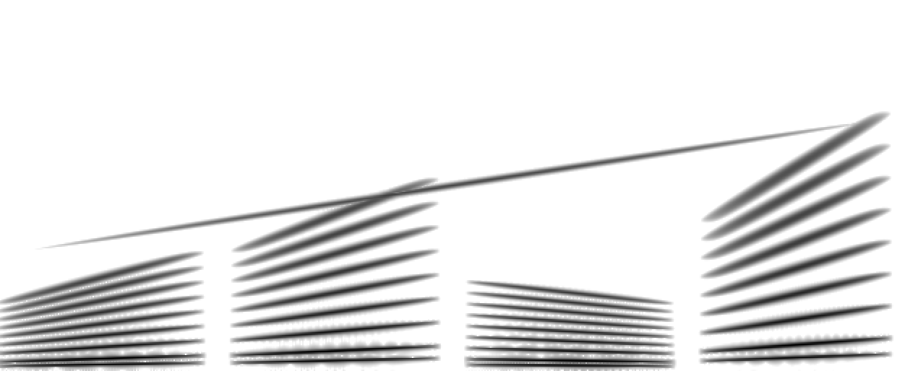

# Spectrogram Audio Recovery

[](https://github.com/zhangshaojia07/spectrogram-audio-recovery/actions/workflows/ci.yml)
[](https://www.python.org/)
[](LICENSE)
[](https://github.com/astral-sh/uv)

Encode an audio file as a compact grayscale spectrogram image, then reconstruct
a playable waveform from that image alone with Griffin-Lim phase retrieval.

The image keeps only the magnitude of the short-time Fourier transform, so the
reconstruction is lossy: the decoder has to estimate the missing phase.  The
time-frequency structure, the duration, and the bandwidth of the original clip
are preserved.  The result is a small, reproducible codec for experiments in
spectrogram visualization, visual audio storage, and phase retrieval.



## Features

- Deterministic encoding: one pixel column per STFT frame, one pixel row per
  frequency bin, lossless PNG output.
- Self-describing images: a JSON sidecar stores the time span, frequency range,
  dynamic range, and all decoder defaults.
- CLI with `encode`, `decode`, and `roundtrip` commands.
- Python API for embedding the codec in other programs.
- Optional diagnostic figure showing the recovered spectrogram, the waveform,
  and the spectrogram of the reconstruction.
- Managed with [uv](https://github.com/astral-sh/uv); tested on Python 3.12 and
  3.13.

## Quick start

```bash
uv sync
uv run python examples/generate_demo.py

uv run spectrogram-audio encode examples/demo.wav \
    -o examples/out/demo.png \
    --freq-max 8000 --height 257 --n-fft 1024 --hop-length 64

uv run spectrogram-audio decode examples/out/demo.png \
    -o examples/out/demo_recovered.wav --n-iter 64
```

Or run the whole pipeline in one command:

```bash
uv run spectrogram-audio roundtrip examples/demo.wav \
    -o examples/out/demo_recovered.wav \
    --image-out examples/out/demo.png \
    --freq-max 8000 --height 257 --n-fft 1024 --hop-length 64 \
    --n-iter 64
```

The commands print a short summary:

```text
Wrote spectrogram image : examples/out/demo.png
  image size      : 626 x 257 px
  source          : 16000 Hz, 2.500 s
  frequency range : 0 - 8000 Hz
  dynamic range   : -80 - 0 dB
  metadata        : examples/out/demo.json
Wrote audio             : examples/out/demo_recovered.wav
  duration        : 2.500 s
  sample rate     : 16000 Hz
  STFT            : n_fft=512, hop=64
  Griffin-Lim     : 64 iterations
  peak / RMS      : 0.950 / 0.154
  metadata        : examples/out/demo.json
```

To generate a diagnostic figure as well, install the plotting extra and pass
`--plot`:

```bash
uv sync --extra plot
uv run spectrogram-audio decode examples/out/demo.png \
    -o examples/out/demo_recovered.wav \
    --plot examples/out/diagnostics.png
```

## Installation

The project requires Python 3.12 or newer and uses uv for dependency
management:

```bash
git clone git@github.com:zhangshaojia07/spectrogram-audio-recovery.git
cd spectrogram-audio-recovery
uv sync
```

To install the package into an existing environment:

```bash
uv pip install .
```

## How it works

```text
              encode                                   decode
audio -----------------> magnitude (dB) ---> PNG ---> magnitude ---> audio
        STFT, log scale      quantize 8-bit     read     Griffin-Lim
```

1. The input is mixed down to mono and analyzed with a short-time Fourier
   transform.
2. Magnitudes are converted to decibels relative to the loudest bin and clipped
   to a configurable dynamic range, by default -80 dB to 0 dB.
3. Frequency bins are interpolated onto `height` rows between 0 Hz and
   `freq_max`.  Each row is mapped linearly onto 0-255, with white for the
   quietest level and black for the loudest, then the image is flipped so that
   low frequencies appear at the bottom.
4. The decoder reverses the mapping, converts decibels back to linear
   magnitude, and runs Griffin-Lim to estimate a phase-consistent waveform.
5. The output is written as 16-bit PCM at `2 * freq_max` hertz, which is the
   Nyquist rate of the encoded band and makes the frequency rows line up
   exactly with the decoder's STFT bins.

Because the image has one column per frame and `n_fft = 2 * (height - 1)`,
the decoder can recover the magnitude grid exactly, apart from the 8-bit
quantization step of `(max_db - min_db) / 255` decibels.

## Metadata sidecar

The image alone does not contain the original duration or frequency range, so
`encode` writes a JSON file next to it.  `decode` loads `<image>.json`
automatically when it exists.

```json
{
  "duration": 2.5,
  "format": "spectrogram-audio",
  "freq_max": 8000.0,
  "gain_db": 0.0,
  "generator": "spectrogram-audio",
  "height": 257,
  "hop_length": 64,
  "max_db": 0.0,
  "min_db": -80.0,
  "n_fft": 1024,
  "sample_rate": 16000,
  "version": 1,
  "width": 626,
  "win_length": 128
}
```

If a sidecar is unavailable, pass the required values explicitly:

```bash
uv run spectrogram-audio decode spectrogram.png -o recovered.wav \
    --duration 2.5 --freq-max 8000 --min-db -80 --max-db 0
```

## Command-line reference

```text
spectrogram-audio encode INPUT -o IMAGE [options]
spectrogram-audio decode IMAGE -o OUTPUT.wav [options]
spectrogram-audio roundtrip INPUT -o OUTPUT.wav [options]
```

| Option | Default | Description |
| --- | --- | --- |
| `--freq-max HZ` | `3000` | Highest encoded frequency. Must not exceed the Nyquist frequency of the input. |
| `--height PX` | `160` | Image height. The decoder derives `n_fft = 2 * (height - 1)`. |
| `--n-fft N` | `2048` | FFT size used during encoding. |
| `--hop-length N` | `128` | Hop size in input samples. Smaller values give finer time resolution and wider images. |
| `--min-db` / `--max-db` | `-80` / `0` | Dynamic range mapped to white and black. |
| `--gain-db` | `0` | Amplitude offset applied before phase retrieval. |
| `--win-length` | `128` | Window length recommended to Griffin-Lim. Clamped to `n_fft`. |
| `--n-iter` | `32` | Number of Griffin-Lim iterations. |
| `--no-normalize` | off | Keep the raw reconstruction level instead of peak normalization. |
| `--metadata` | auto | Use a specific metadata sidecar. |
| `--no-metadata` | off | Do not write or read a sidecar. |
| `--plot PATH` | off | Write a diagnostic figure. Requires the `plot` extra. |

Run `uv run spectrogram-audio <command> --help` for the full list.


## Python API

```python
from spectrogram_audio import SpectrogramMetadata, decode_file, encode_file

encoded = encode_file(
    "input.wav",
    "spectrogram.png",
    freq_max=4000,
    height=257,
    n_fft=1024,
    hop_length=64,
)

metadata = SpectrogramMetadata.load("spectrogram.json")
decoded = decode_file(
    "spectrogram.png",
    "recovered.wav",
    metadata=metadata,
    n_iter=64,
)

print(decoded.duration, decoded.sample_rate, decoded.peak)
```

Lower-level helpers are exported as well: `stft_db`, `db_to_uint8`,
`uint8_to_db`, `load_image`, `save_image`, and `decode_spectrogram`.

## Choosing parameters

- **Bandwidth**: `--freq-max` sets the encoded bandwidth and the output sample
  rate. Speech is usually intelligible with 3000-4000 Hz; music sounds better
  with 8000 Hz or more.
- **Frequency resolution**: `--height` controls the image height and the
  decoder's FFT size. Values are typically odd so that
  `n_fft = 2 * (height - 1)` is a power of two, for example `height=257`
  gives `n_fft=512`.
- **Time resolution**: `--hop-length` controls the number of pixels per second
  and the image width. Smaller hops preserve transients but produce wider
  images.
- **Reconstruction quality**: more Griffin-Lim iterations improve phase
  consistency at the cost of runtime. Around 32-64 iterations is a good
  trade-off for short clips.

## Quality and limitations

- Phase is not stored. Griffin-Lim produces a plausible but not identical
  waveform; the result often sounds reverberant or "phasey", especially for
  speech.
- The 8-bit image quantizes levels to `(max_db - min_db) / 255` decibels. A
  narrower range improves precision for quiet material but clips more.
- Do not resize, crop, or lossily recompress the PNG. The decoder assumes
  exactly one column per frame and one row per frequency bin.
- The output sample rate is always `2 * freq_max`, so wideband source material
  must be low-pass filtered by choosing a suitable `--freq-max`.
- Absolute loudness is not preserved because levels are normalized to the
  loudest bin. Peak normalization is enabled by default for playback.

## Development

```bash
uv sync --all-extras
uv run ruff check .
uv run ruff format --check .
uv run pytest
```

The test suite uses synthetic signals only, so it runs offline and does not
depend on the demo recording.

## Project layout

```text
.
|-- src/spectrogram_audio/
|   |-- __init__.py       Public API
|   |-- __main__.py       python -m spectrogram_audio
|   |-- cli.py            Command-line interface
|   |-- codec.py          File-level encode and decode operations
|   |-- errors.py         Exception types
|   |-- metadata.py       JSON sidecar model
|   |-- plotting.py       Optional diagnostic figures
|   `-- spectrogram.py    Spectrogram <-> image conversions
|-- tests/                Unit and end-to-end tests
|-- examples/             Demo signal generator and local outputs
|-- docs/                 Images used by this README
`-- .github/workflows/    Continuous integration
```

## References

- D. W. Griffin and J. S. Lim, "Signal estimation from modified short-time
  Fourier transform," IEEE Transactions on Acoustics, Speech, and Signal
  Processing, 1984.
- [librosa](https://librosa.org/) - audio and music analysis in Python.

## License

Released under the MIT License.  See [LICENSE](LICENSE) for details.

